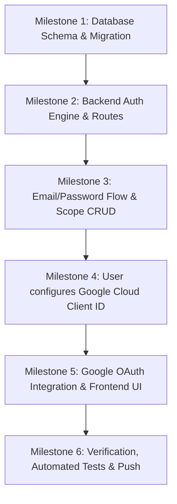

# QueueMe: Authentication & Authorization Implementation Plan

This document outlines the complete architectural and engineering roadmap for adding multi-user Authentication and Authorization to **QueueMe** using **Google OAuth (Primary 1-Click)** and **Email/Password (Fallback)** with JWT-based session security.

---

## 📌 Architecture Overview

```
┌────────────────────────────────────────────────────────────────────────┐
│                        Frontend (Cloudflare Pages)                     │
│                                                                        │
│   ┌────────────────────────┐             ┌─────────────────────────┐   │
│   │ Google Sign-In Button  │             │   Email / Password Form │   │
│   │ (Google Identity SDK)  │             │   (Signup & Login)      │   │
│   └───────────┬────────────┘             └────────────┬────────────┘   │
│               │ ID Token (JWT)                        │ Credentials    │
│               ▼                                       ▼                │
│    POST /api/auth/google                  POST /api/auth/login|register│
└───────────────────────┬───────────────────────────────┬────────────────┘
                        │                               │
                        │                               │
┌───────────────────────▼───────────────────────────────▼────────────────┐
│                           Backend (Render)                             │
│                                                                        │
│   1. Verify Google Token (google-auth-library) OR bcrypt password hash │
│   2. Find or Create User in PostgreSQL                                 │
│   3. Issue QueueMe App JWT (Bearer Token)                              │
│                                                                        │
│   Protected Routes (/api/items/*):                                     │
│   - authMiddleware checks Bearer Token                                 │
│   - Injects req.userId                                                 │
│   - All Prisma queries scoped: where: { userId: req.userId }           │
└───────────────────────────────────────┬────────────────────────────────┘
                                        │
┌───────────────────────────────────────▼────────────────────────────────┐
│                       Database (Neon PostgreSQL)                       │
│                                                                        │
│      users (id, email, password, name, avatarUrl, provider)            │
│        └── 1:N ──> items (id, userId, title, type, status, ...)        │
└────────────────────────────────────────────────────────────────────────┘
```

---

## 🚦 When Google OAuth Setup is Needed from You

> [!IMPORTANT]
> **Action Required from You in Step 4:**
> We can build and test **Step 1 (Database)**, **Step 2 (Backend Auth Engine + Email/Password)**, and the **Step 3 UI scaffolding** first.
> 
> **When we are ready to test Google Sign-In (Step 4)**, you will need to spend 3 minutes in the Google Cloud Console to create an OAuth Client ID and paste the client ID into `.env`. Step 4 below gives exact copy-paste URLs and click-by-click instructions.

---

## 🛠️ Step 1: Database Schema & Migration (Prisma + Neon)

### 1.1 Update `server/prisma/schema.prisma`
Add the `User` model and link it to the existing `Item` model:

```prisma
enum AuthProvider {
  LOCAL
  GOOGLE
}

model User {
  id         String       @id @default(uuid())
  email      String       @unique
  password   String?      // Nullable: Null for Google OAuth users, hashed for Email users
  name       String?
  avatarUrl  String?
  provider   AuthProvider @default(LOCAL)
  googleId   String?      @unique
  items      Item[]
  createdAt  DateTime     @default(now())
  updatedAt  DateTime     @updatedAt

  @@map("users")
}

model Item {
  id            String       @id @default(uuid())
  userId        String
  user          User         @relation(fields: [userId], references: [id], onDelete: Cascade)
  title         String
  type          MediaType
  creator       String       @default("")
  platform      String       @default("")
  duration      String       @default("")
  progress      Int          @default(0)
  progressLabel String       @default("Not started")
  status        ItemStatus   @default(queued)
  priority      ItemPriority @default(medium)
  releaseYear   String?
  rating        String?
  tags          String[]     @default([])
  coverImage    String?
  url           String?
  sourceUrl     String?
  notes         String?
  addedDate     String?
  createdAt     DateTime     @default(now())
  updatedAt     DateTime     @updatedAt

  @@index([userId])
  @@index([status])
  @@index([type])
  @@index([priority])
  @@map("items")
}
```

### 1.2 Run Migration
Because the database currently has **0 items**, applying this migration will succeed cleanly without migration conflicts or orphaned rows:
```bash
cd server
npx prisma migrate dev --name add_user_authentication
```

---

## ⚙️ Step 2: Backend Authentication Engine (Express)

### 2.1 Backend Dependencies
Install in `server/`:
- `bcryptjs`: Secure one-way salt & hash for passwords.
- `jsonwebtoken`: Signing and validating QueueMe JWT Bearer tokens.
- `google-auth-library`: Official Google library to securely verify Google ID tokens passed from the frontend.

### 2.2 Auth Middleware (`server/src/middlewares/auth.js`)
- Reads header: `Authorization: Bearer <token>`.
- Verifies token signature with `JWT_SECRET`.
- Attaches `req.userId` and `req.user` to Express request object.
- Returns `401 Unauthorized` if token is missing or invalid.

### 2.3 Auth Controller & Routes (`/api/auth/*`)
- **`POST /api/auth/register`**:
  - Validates email format and password strength (min 6 chars) using Zod.
  - Checks if email is already taken.
  - Hashes password with bcrypt (salt rounds = 10).
  - Creates user in PostgreSQL (`provider: LOCAL`).
  - Returns JWT + safe user object `{ id, email, name, avatarUrl }`.
- **`POST /api/auth/login`**:
  - Finds user by email.
  - If user signed up via Google, returns helpful message ("Please log in with Google").
  - Verifies password with `bcrypt.compare`.
  - Returns JWT + safe user object.
- **`POST /api/auth/google`**:
  - Receives `{ credential }` (Google ID Token from Google One-Tap / button).
  - Verifies token using `google-auth-library` and your `GOOGLE_CLIENT_ID`.
  - Extracts Google `sub` (Google ID), `email`, `name`, and `picture`.
  - Finds existing user by `googleId` or `email`, or creates a new user (`provider: GOOGLE`).
  - Returns JWT + safe user object.
- **`GET /api/auth/me`**:
  - Protected route returning the current user profile from DB.

### 2.4 Scope All Item CRUD Operations to `req.userId`
Update [server/src/controllers/itemController.js](file:///home/atanu/Desktop/queueme/server/src/controllers/itemController.js):
- **`getItems`**: Query filter: `where: { ...filters, userId: req.userId }`.
- **`getItemById`**: Query filter: `where: { id, userId: req.userId }`.
- **`createItem`**: `data: { ...body, userId: req.userId }`.
- **`updateItem`**: Ensures item belongs to `req.userId` before updating.
- **`deleteItem`**: Ensures item belongs to `req.userId` before deleting.

---

## 💻 Step 3: Frontend State & UI Architecture (React 19)

### 3.1 Authentication Context (`client/src/context/AuthContext.jsx`)
- State: `{ user, token, isAuthenticated, isLoading }`.
- On app mount: checks `localStorage` for `queueme_auth_token`, calls `GET /api/auth/me` to hydrate user session.
- Exposes: `login(email, password)`, `register(email, password, name)`, `loginWithGoogle(credential)`, `logout()`.

### 3.2 Update `apiService.js`
- Intercepts all fetch requests:
  ```javascript
  const token = localStorage.getItem('queueme_auth_token');
  if (token) {
    headers['Authorization'] = `Bearer ${token}`;
  }
  ```
- On `401 Unauthorized`: clears token and triggers logout state so user is redirected to login.

### 3.3 Auth Modal / Screen (`client/src/components/auth/AuthModal.jsx`)
- Sleek, modern modal matching the QueueMe dark theme (`bg-zinc-950`, border `zinc-800`).
- **Primary section**: Official Google Sign-In button powered by `@react-oauth/google` or Google Identity script.
- **Divider**: *"or continue with email"*.
- **Email Form**:
  - Name input (visible only when in "Sign Up" mode).
  - Email input.
  - Password input.
  - Switcher button: *"Already have an account? Sign in"* / *"Don't have an account? Sign up"*.
- Form validation & clear error feedback (e.g. "Email already registered", "Incorrect password").

### 3.4 Dynamic Sidebar & Navigation
Update [Sidebar.jsx](file:///home/atanu/Desktop/queueme/client/src/components/layout/Sidebar.jsx) and [MobileNav.jsx](file:///home/atanu/Desktop/queueme/client/src/components/layout/MobileNav.jsx):
- Replace static avatar with real `user.avatarUrl` (Google profile picture) or initials avatar with `user.name`.
- Show user's actual email/name.
- Add a clean **Sign Out** button with an exit icon.

---

## 🔑 Step 4: Google Cloud OAuth Setup (When We Reach Here)

### 4.1 What You Will Need to Do in Google Cloud Console
1. Go to [Google Cloud Console](https://console.cloud.google.com/).
2. Create a new project (e.g. `QueueMe App`).
3. Under **APIs & Services** > **OAuth consent screen**:
   - Choose **External**.
   - App Name: `QueueMe`.
   - User Support Email: your email.
4. Under **APIs & Services** > **Credentials**:
   - Click **Create Credentials** > **OAuth client ID**.
   - Application type: **Web application**.
   - **Authorized JavaScript origins**:
     - `http://localhost:5173` (for local frontend dev)
     - `https://<your-cloudflare-subdomain>.pages.dev` (for Cloudflare production)
5. Copy the generated **Client ID** (looks like: `xxxxxxxxxx-xxxxxxxx.apps.googleusercontent.com`).

### 4.2 Environment Variables Matrix

| Environment | Variable | Location | Value |
| :--- | :--- | :--- | :--- |
| **Backend (Local)** | `JWT_SECRET` | `server/.env` | Random 64-character secret string |
| **Backend (Local)** | `GOOGLE_CLIENT_ID` | `server/.env` | Google Client ID from Step 4.1 |
| **Backend (Render)** | `JWT_SECRET` | Render Environment settings | Same secret string |
| **Backend (Render)** | `GOOGLE_CLIENT_ID` | Render Environment settings | Same Google Client ID |
| **Frontend (Local)** | `VITE_GOOGLE_CLIENT_ID` | `client/.env` | Same Google Client ID |
| **Frontend (Cloudflare)** | `VITE_GOOGLE_CLIENT_ID` | Cloudflare Pages Environment | Same Google Client ID |

---

## 📋 Execution Order & Milestones



1. **Phase 1 (Immediate)**: Update Prisma schema, create migrations, install backend auth dependencies (`bcryptjs`, `jsonwebtoken`, `google-auth-library`).
2. **Phase 2**: Implement `authMiddleware`, `/api/auth/register`, `/api/auth/login`, and scope `/api/items/*` to `userId`.
3. **Phase 3**: Implement frontend `AuthContext`, `AuthModal` (email/password mode), attach Bearer token to `apiService.js`, update Sidebar user profile and Sign Out.
4. **Phase 4 (Your Input)**: I will pause and notify you to create the Google OAuth Client ID in Google Cloud Console.
5. **Phase 5**: Wire Google Sign-In into `AuthModal` and `/api/auth/google`.
6. **Phase 6**: Run tests, verify multi-user isolation, and prepare for deployment.
